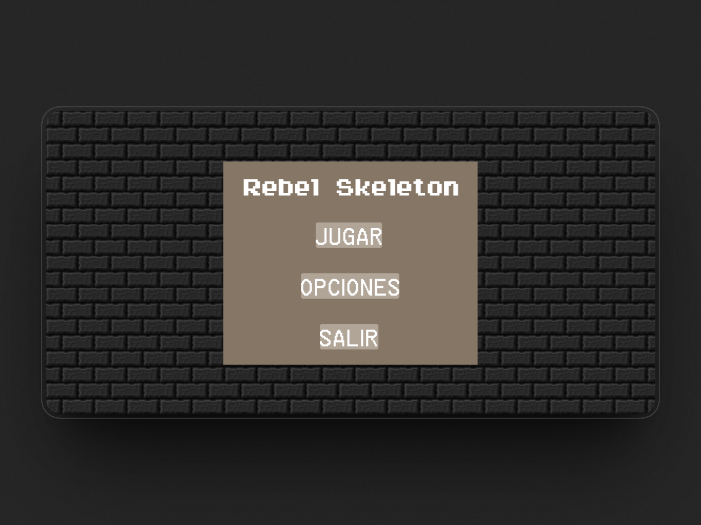
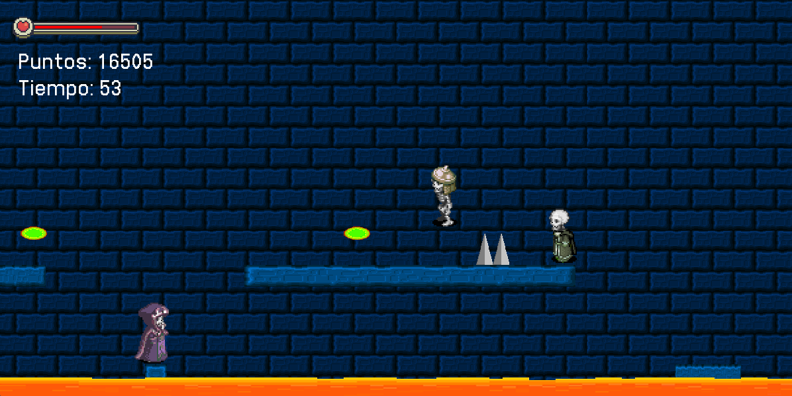

# SEGUNDO PARCIAL DE PROGRAMACIÓN I - MAURICIO HARRIET

# I. FUNDAMENTACIÓN:
Este proyecto integra los contenidos vistos en las materias de Programación 1 y Laboratorio 1 de la Tecnicatura en Programación de la UTN:

1. Sintaxis: Escritura y organización del código en Python.
2. Variables y tipos de datos: Uso de números, textos, listas, tuplas y diccionarios para guardar información.
3. Estructuras de control: Uso de condiciones y bucles para controlar el funcionamiento del juego.
4. Funciones: Creación de bloques de código que permiten organizar y reutilizar instrucciones.
5. Eventos: Detección de las acciones del jugador, como por ejemplo, apretar botones.
6. Bibliotecas y módulos: Uso de herramientas externas y archivos propios para organizar más el código.
7. Manejo de errores: Control de situaciones, como por ejemplo, la detección de la ausencia del archivo de guardado.
8. Archivos: Lectura y escritura de datos para guardar la puntuación máxima.
9. Movimiento y colisiones: Control del movimiento de los vehículos y detección de impactos/choques con otros objetos.
10. Elementos aleatorios: Selección al azar de vehículos y detección de choques con otros objetos.
11. Utilización de Pygame: Creación de la interfaz gráfica, movimiento de objetos, reproducción de sonidos y control de los eventos del juego.
12. Utilización de clases: Una plantilla para la creación de objetos. Define un conjunto de atributos y métodos comunes a todos los objetos que se crean a partir de ella. Los objetos son instancias de una clase y heredan las características definidas en la clase.
13. JSON: Uso de archivos JSON para guardar ranking.

# II. DESCRIPCIÓN GENERAL DEL PROYECTO:
El proyecto trata de un juego de estilo arcade llamado que cumple con las siguientes condiciones:

1. Jugador: Personaje controlado por el jugador, puede obtener puntos derrotando enemigos y recolectando monedas.
2. Enemigos: Distintas criaturas con movimientos y ataques propios, pueden atacar al jugador y pueden ser destruidos por proyectiles.
3. Jefe Final: El juego posee de un Jefe en el ultimo nivel del juego con una mayor dificultad a comparación de las demás criaturas.
4. Terreno y plataformas: El juego cuenta con plataformas móviles y elementos estáticos.
5. Proyectiles: El juego posee proyectiles que pueden ser disparados tanto por el jugador como por enemigos.
6. Barra de vida: El jugador posee una barra de vida, dicha barra de vida se vacia al recibir 3 golpes, si ocurre esto, el jugador pierde una vida.
7. Corazones: Hay corazones esparcidos por el mapa, sirven para que el jugador los recolecte y se cure.
8. Vidas: El jugador cuenta únicamente con 3 vidas en el juego. Si pierde las 3 vidas, perderá el juego.
9. Trampas: En los distintos niveles, hay trampas colocadas con el fin de lastimar al jugador.
10. Cronómetro: El juego consta de un cronómetro. El juego termina cuando llega a 0.
11. Ítems: Por todo el mapa, el jugador se podrá encontrar con objetos, tanto monedas, como corazones como también relojes para aumentar el tiempo del cronómetro para tener más tiempo.
12. Niveles: El juego consta de 3 niveles con distintos mapas y enemigos.
13. Movimiento: El jugador puede moverse horizontalmente y saltar, los enemigos poseen movimientos propios y autónomos y cambian de dirección al alcanzar limites horizonatales.
14. Efectos de sonido acompañan acciones del jugador, de los ítems y de los enemigos.
15. Música ambiental durante el gameplay.
16. Pantallas de juego:

. Selección de niveles: El juego visualiza una pantalla de selección de 3 niveles, se podrá acceder a niveles superiores una vez completados. Al mismo tiempo enseña los records establecidos por otros jugadores.
. Configuración: Esta pantalla permite encender y apagar la música y los efectos de sonido del juego.

# III. CONSIDERACIONES FINALES
Este proyecto es de mi autoría, pero la aplicación de conceptos se da en base a los conocimientos vistos en las clases de Programación 1 y Laboratorio 1, gracias a los profesores de dichas materias. El código del juego es de mi producción, en cambio los sprites y los sonidos del juego se consiguieron de manera gratuita a través de internet.

Se necesita la instalación de pygame 2.5.2 para hacer funcionar el proyecto.

[Gameplay del Juego](https://youtu.be/-nF2ws_Aq6U?si=VrNfrdFZPmhjLwgf)
